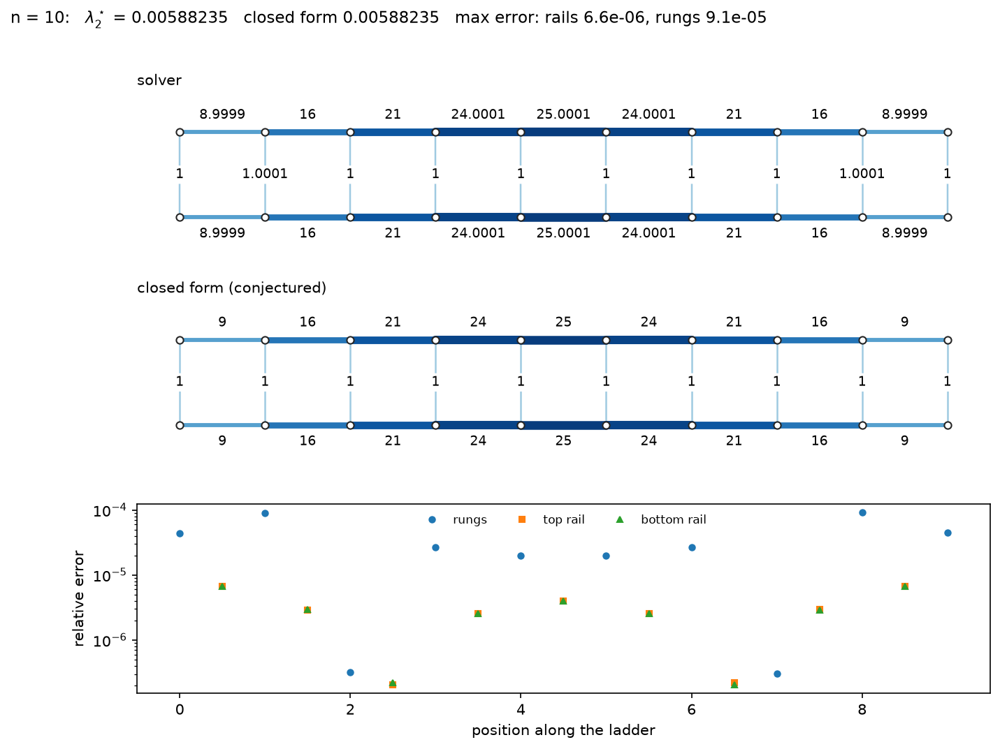

# gap-maximizing-on-ladders

Gap-optimal edge conductances on ladder graphs via semidefinite programming,
with a numerically observed closed form for the optimum.



## The problem

Let $`\mathcal L_n = P_n \square P_2`$ be the ladder graph with $`n`$ rungs
($`2n`$ vertices, $`3n-2`$ edges). For edge conductances $`w \ge 0`$ let $`L(w)`$ be the
weighted graph Laplacian. We maximise its algebraic connectivity under a unit budget:

```math
\lambda_2^\star(n) = \max_{w \ge 0,\ \sum_e w_e = 1} \lambda_2\big(L(w)\big).
```

The function $`w \mapsto \lambda_2(L(w))`$ is concave and the problem is a
semidefinite program, which this package solves with
[CVXPY](https://www.cvxpy.org/) and the Clarabel interior-point solver.

**Motivation.** By Aldous' spectral gap theorem (proved by Caputo, Liggett and
Richthammer, 2010), the spectral gap of the ferromagnetic Heisenberg model on a
graph with couplings $`J_{ij}`$ equals the algebraic connectivity of the graph
weighted by $`J`$ (up to the normalisation of the couplings). So the problem above is the
question of which couplings of a Heisenberg spin ladder give the largest spectral
gap for a fixed total coupling. A preprint on this question is in preparation;
this repository is its numerical companion.

## Observed closed form (conjecture, not proved)

Numerical solutions for the ladder with $`n`$ rungs and unit budget match:

| edges | conductance |
|---|---|
| each of the $`n`$ rungs | $`u_n = \dfrac{3}{n(n^2+2)}`$ |
| rail edge joining positions $`i`$ and $`i+1`$, $`i = 1,\dots,n-1`$ (both rails) | $`i(n-i)u_n`$ |

and the optimal value is

```math
\lambda_2^\star(n) = 2u_n = \frac{6}{n(n^2+2)}.
```

What has been checked (see `tests/test_closed_form.py` and `scripts/closed_form_table.py`):

* **Feasibility and value, no solver involved.** The formulas above sum to 1 and give
  $`\lambda_2 = 2u_n`$ exactly (to rounding) for every $`n = 1, \dots, 100`$ tried.
* **Spectrum.** The spectrum of $`L(w)`$ at the closed form is
  $`u_n\lbrace k(k+1)\rbrace_{k=0}^{n-1} \cup u_n\lbrace k(k+1)+2\rbrace_{k=0}^{n-1}`$ for $`n = 1,\dots,100`$.
  In particular $`\lambda_2`$ has multiplicity exactly 2 there.
* **Agreement with the SDP solver.** For $`n \le 30`$ the solver's optimal value agrees with
  $`6/(n(n^2+2))`$ to a relative error of at most $`1.1\cdot10^{-7}`$, and the rail conductances to at most $`2.0\cdot10^{-4}`$. For $`n = 50`$ the value agrees to $`4\cdot10^{-8}`$.

What has not: there is **no proof** that the closed form is optimal, and no proof that
the optimiser is unique.

**A caveat on the rungs.** The optimum is very flat in the rung conductances: moving
budget between rungs changes $`\lambda_2`$ only to second order. The solver therefore pins
the rungs down much less accurately than the rails or the value (up to $`1.5\cdot10^{-2}`$
relative error for $`n \le 30`$, and about $`5\%`$ at the end rungs for $`n = 50`$), and
tightening its tolerances does not help. Comparisons between solved and closed-form
conductances should be read with this in mind.

## Installation

```bash
git clone https://github.com/probabilist-jnieminen/gap-maximizing-on-ladders.git
cd gap-maximizing-on-ladders
python3 -m venv .venv
source .venv/bin/activate
pip install -e ".[dev]"
pytest
```

## Usage

Solve one ladder, e.g. $`n = 10`$, and compare with the closed form:

```bash
python scripts/solve_and_draw.py 10
```

This writes to `results/`: the solved conductances with the closed form and the relative
error per edge (`ladder_n10.csv`), a drawing of the solved ladder (`ladder_n10.pdf`), and a
three-panel figure with the solved ladder, the closed-form ladder and the relative error per
edge (`ladder_n10_vs_closed_form.pdf` and `.png`).

Compare solver and closed form for $`n = 1, \dots, 30`$ (writes `results/closed_form_errors.*`):

```bash
python scripts/closed_form_table.py
```

`scripts/run_baseline.py` prints a summary table of the solver alone for $`n = 2,\dots,20`$.

From Python:

```python
from gap_maximizing_on_ladders import solve_ladder, closed_form_w, closed_form_lambda2

sol = solve_ladder(10)                  # sol.w follows make_ladder(10).edges
print(sol.lambda2, closed_form_lambda2(10))
print(abs(sol.w - closed_form_w(10)).max())
```

## Repository layout

| path | content |
|---|---|
| `gap_maximizing_on_ladders/ladder.py` | ladder graph, edge order, incidence matrix |
| `gap_maximizing_on_ladders/laplacian.py` | $`L(w) = B^\top \mathrm{diag}(w) B`$, algebraic connectivity |
| `gap_maximizing_on_ladders/solver.py` | the SDP (CVXPY, Clarabel by default) |
| `gap_maximizing_on_ladders/closed_form.py` | the conjectured closed form |
| `gap_maximizing_on_ladders/plotting.py` | ladder drawings and the comparison figure |
| `scripts/` | command-line scripts (above) |
| `tests/` | pytest suite |
| `results/` | generated output |
| `docs/` | incomplete draft LaTeX documentation of the mathematics and the design decisions |

## Status and next steps

- [x] SDP solver, tests, drawings
- [x] Numerical comparison with the observed closed form
- [ ] Proof of the closed form (e.g. via a dual certificate)
- [ ] Symmetry-reduced SDP for speed at large $`n`$ (the full SDP takes about a minute at $`n = 50`$)
- [ ] Other families: $`k`$-rail ladders, circular ladders

## References

* P. Caputo, T. M. Liggett, T. Richthammer, *Proof of Aldous' spectral gap conjecture*, J. Amer. Math. Soc. 23 (2010), 831–851.
* L. Vandenberghe, S. Boyd, *Semidefinite programming*, SIAM Review 38 (1996), 49–95.
* J. Sun, S. Boyd, L. Xiao, P. Diaconis, *The fastest mixing Markov process on a graph and a connection to a maximum variance unfolding problem*, SIAM Review 48 (2006), 681–699.

## Reproducibility

The committed results in `results/` were produced with Python 3.12.3, numpy 2.5.3,
scipy 1.18.1, cvxpy 1.9.3 and Clarabel 0.11.1 (full list in `requirements-lock.txt`).
Small differences in the solver output, especially in the rung conductances, are
expected with other versions or on other machines.

## License

MIT, see `LICENSE`.
